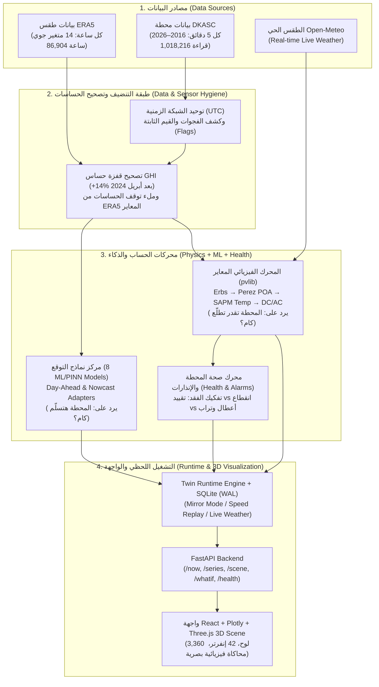

# الدليل الشامل لعرض ومناقشة مشروع التخرج: Yulara Station Twin (Digital Shadow)

> **الغرض من هذا الملف:** هذا المستند مكتوب خصيصًا لك باللغة العربية (مع الحفاظ على المصطلحات الهندسية والبرمجية بالإنجليزية) ليكون مرجعك الكامل لفهم كل تفصيلة ورقم وقرار هندسي في المشروع، ولتستخدمه مباشرةً في بناء شرائح العرض (Presentation Slides) وتقديم الـ Live Demo أمام دكتور القسم غدًا بثقة كاملة.

---

## الجزء الأول: الفكرة الجوهرية للمشروع في دقيقة واحدة (The Elevator Pitch)

لو سألك الدكتور في أول دقيقة: **"إنتو عملتوا إيه في الجزء ده من المشروع؟ وفارق إيه عن شغل التوقع العادي؟"**، إجابتك هي:

1. **إحنا بنينا Digital Shadow (ظل رقمي) كامل لمحطة طاقة شمسية حقيقية** هي محطة **Yulara 1 – Desert Gardens** في وسط أستراليا (بقدرة **1,058.4 kW DC** و**3,360 لوح شمسي**)، على بيانات تشغيل حقيقية مدتها **10 سنوات** (أكثر من **مليون قراءة** كل 5 دقائق من 2016 إلى 2026).
2. **ليه سميناه Digital Shadow مش Digital Twin؟**
   طبقًا للتعريف الأكاديمي المعتمد (**Kritzinger et al., 2018**):
   - الـ **Digital Twin** يتطلب تدفق بيانات أوتوماتيكي في **اتجاهين** (قراءة من المحطة + إرسال أوامر تحكم أوتوماتيكية للمحطة).
   - الـ **Digital Shadow** يتطلب تدفق بيانات أوتوماتيكي في **اتجاه واحد** (من المحطة الفعلية إلى النموذج الرقمي لحظة بلحظة)، بينما الاتجاه الراجع يتم عبر **توصيات هندسية للمشغّل البشري (Human-in-the-loop)**: *"افحص الإنفرترات"*، *"نظّف الألواح"*، *"تأكد من التقييد"*. وبما أننا لا نملك صلاحية إرسال أوامر تحكم لمحطة Yulara في أستراليا، فالتوصيف العلمي الدقيق لنظامنا هو **Digital Shadow**.
3. **المشكلة الكبرى اللي التوأم كشفها وحلّها:**
   لما فريق الـ Machine Learning بدأ يدرب موديلات التوقع على بيانات المحطة، لقوا إن العلاقة المباشرة بين إشعاع الشمس والقدرة الخارجة ضعيفة جدًا ($R^2 = 0.31$ ومعامل الارتباط $0.54$ فقط!).
   - لما بنينا **النموذج الفيزيائي المعاير (Calibrated Physics Model)** جوه التوأم وقارناه بالبيانات، أثبتنا بالأرقام إن المشكلة **مش في بيانات الطقس ولا في الألواح ولا في ظل الصفوف**، بل إن المحطة بتتعرض لـ **تقييد إنتاج متكرر وقت الضهر (Curtailment / Output Limiting)**: في 70.7% من ساعات الذروة المشمسة (`GHI > 850 W/m²`) بيكون الخرج أقل من نص المتوقع فيزيائيًا (`750–900 kW`)، وبتثبت القدرة أحيانًا عند قيم متكررة مثل `50 kW` أو `310 kW` أو `40 kW` (بينما أقصى قدرة مسجلة للمحطة هي `915.97 kW`). وبما إن المحطة متصلة بشبكة معزولة لمنتجع (**Isolated Microgrid — Ayers Rock Resort**)، فأقوى تفسير هندسي عندنا — في انتظار تأكيد المشغّل — إن الشبكة بتقيّد الخرج على قد الحمل/استقرار الشبكة!
   - التوأم بتاعنا قدر يفصل بدقة بين **3 حاجات كانت سايحة على بعض**:
     1. **المحطة تقدر تطلّع كام فيزيائيًا؟ (Physics Potential)** — بدقة خطأ **3.18% فقط (33.7 kW)** لما المحطة تكون حرة.
     2. **المحطة هتسلّم كام فعلًا للشبكة؟ (ML Forecast)** — باستخدام 8 موديلات (منها CNN-LSTM DP-PINN و LightGBM Nowcast) بدقة **3.40% (36.0 kW)** لأن الـ ML اتعلم سلوك التقييد.
     3. **الطاقة الضائعة راحت فين؟** هل ضاعت بسبب **تقييد الشبكة (25% إلى 54% سنويًا)**، ولا بسبب **انقطاع كامل (Outage)**، ولا بسبب **تقادم وأعطال وتراب في المحطة نفسها (Health Loss)**؟

---

## الجزء الثاني: هيكل العرض المقترح للدكتور (Slide-by-Slide Blueprint)

يمكنك تقسيم العرض التقديمي (PowerPoint / Canva) إلى **12 شريحة (Slides)** مرتبة كالتالي:

---

### الشريحة 1: العنوان والتعريف بالنظام (Title Slide)
- **العنوان على الشريحة:**
  **Yulara Solar Station — Physics-Calibrated Digital Shadow & Real-Time Health Monitoring**
- **العناصر على الشريحة:**
  - المحطة المستهدفة: **Yulara 1 – Desert Gardens (DKASC, Australia)** — $1,058.4\text{ kW}_{\text{DC}}$.
  - التكامل بين المحاكاة الفيزيائية (`pvlib`)، نماذج الذكاء الاصطناعي (`DP-PINN` & `LightGBM`)، والمحاكاة ثلاثية الأبعاد (`Three.js`).
- **اللي تقوله للدكتور:**
  *"صباح الخير يا دكتور. النهارده هنعرض الجزء الخاص بالـ Digital Shadow لمحطة Yulara الشمسية. الهدف من الشغل ده إننا منكتفيش بموديل يتوقع رقم القدرة وبس، بل نبني توأم رقمي فيزيائي وتشغيلي كامل يفهم المحطة المفروض تطلّع كام، ويكتشف الأعطال والتقييد ومشاكل الحساسات أوتوماتيك، ويعرض حالة المحطة لحظيًا على مجسم 3D مطابق للواقع."*

---

### الشريحة 2: ليه Digital Shadow؟ وإيه المعمارية الكاملة للنظام؟ (System Architecture)
- **العناصر على الشريحة (مخطط التدفق المعماري):**



- **اللي تقوله للدكتور:**
  - *"النظام مبني على مبدأ الفصل التام بين الطبقات (Separation of Concerns):"*
  - *"كل الإعدادات والحدود الهندسية موجودة في ملفات `YAML` (`station.yaml`, `physics.yaml`, `calibration.yaml`, `twin.yaml`) بحيث أي تعديل في مواصفات المحطة أو حدود الإنذار يتم بدون لمس الكود."*
  - *"الواجهة الأمامية (Frontend) لا تحتوي على أي معادلة رياضية واحدة؛ كل رقم وكل حركة على المجسم ثلاثي الأبعاد (من زاوية الشمس لسرعة الرياح للون سخونية الألواح) جاي مباشرة من الـ API."*

---

### الشريحة 3: تحقيق بيانات المحطة والتصميم الهندسي (Station Facts & Engineering Verification)
- **العناصر على الشريحة:**
  - **المواصفات المؤكدة رسميًا (من DKASC والداتا شيت):**
    - القدرة الاسمية: **$1,058.4\text{ kW}_{\text{DC}}$** مكونة من **3,360 لوح** موديل **Jinko JKM315PP-72** ($315\text{ W}$، Polycrystalline، كفاءة $16.23\%$، معامل حرارة القدرة $\gamma = -0.40\%/^\circ\text{C}$، و $\text{NOCT} = 45^\circ\text{C}$).
    - التركيب: أرضي ثابت، زاوية ميل **$15^\circ$**، موجه ناحية **الشمال الحقيقي ($\text{Azimuth} = 0^\circ$)** لأن المحطة في نصف الكرة الجنوبي ($25.24^\circ\text{ S}, 130.98^\circ\text{ E}$).
    - التوقيت: **ACST (UTC+9:30)** ثابت طوال العام بدون توقيت صيفي.
  - **التصميم الكهربائي والميكانيكي المستنتج هندسيًا (ومُعلّم عليه كـ `Calculated` بشفافية):**
    - موديل الإنفرتر المذكور في DKASC هو **SMA Sunny Tripower 25000TL-30** ($25\text{ kW}_{\text{AC}}$، كفاءة $98.1\%$، أقصى جهد دخل $1,000\text{ V}$).
    - **حساب الـ Strings:** جهد الدائرة المفتوحة للوح $V_{\text{oc}} = 46.2\text{ V}$ $\leftarrow$ $20\text{ لوح} \times 46.2\text{ V} = 924\text{ V} < 1,000\text{ V}$. إذن كل String مكون من **20 لوح**.
    - **حساب عدد الإنفرترات:** $3,360 \div 20 = 168\text{ string}$. كل إنفرتر يأخذ **4 Strings (80 لوح)** بقدرة $80 \times 315\text{ W} = 25.2\text{ kW}_{\text{DC}}$ $\leftarrow$ إذن المحطة بها **42 إنفرتر** بقدرة كلية **$1,050\text{ kW}_{\text{AC}}$**.
    - **التخطيط الهندسي على الأرض (من صور الأقمار الصناعية وOpenStreetMap):** **15 صفًا** في بلوكين (9 صفوف رئيسية + 6 صفوف جنوب غرب)، عمق الصف لوحان Portrait ($3.78\text{ m}$)، والمسافة بين الصفوف $\text{Pitch} = 7\text{ m}$.
- **نقطة مهمة جدًا تقولها للدكتور:**
  *"إحنا صححنا خطأ شائع كان موجود في الأكواد السابقة اللي افترضت إن المحطة في نصف الكرة الشمالي (Azimuth 180° وميل 25° وقدرة 10 kW). وكمان حسبنا هندسيًا ظل الصفوف على بعضها (Row-to-Row Shading): ارتفاع الصف $1\text{ m}$، وفي عز الشتاء في يونيو الشمس وقت الضهر بتكون على ارتفاع $41^\circ$، فطول الظل $1.15\text{ m}$ بينما المسافة الفاضية بين الصفوف $3.2\text{ m}$؛ يعني **مستحيل يحصل ظل بين الصفوف وقت الضهر طوال السنة**، وده دليل قاطع إن هبوط القدرة وقت الضهر سببه تقييد الشبكة مش الظل!"*

---

### الشريحة 4: تنضيف البيانات واكتشاف عيوب الحساسات (Data Hygiene & Sensor Forensics)
- **العناصر على الشريحة:**
  - **توحيد وتنضيف 10 سنوات (2016–2026):**
    - إجمالي الشبكة الزمنية المنتظمة: **1,039,971 خطوة** (كل 5 دقائق بتوقيت UTC)، منها **21,755 خطوة مفقودة** (في **719 فجوة**، أطولها 7 أيام و21 ساعة).
    - إزالة القراءات التالفة: **19,012** قراءة إشعاع غير فيزيائية ($>1500\text{ W/m}^2$ أو الكود `99999.9`)، و**37** قفزة حرارية شاذة (تصل لـ $319^\circ\text{C}$)، وإهمال عداد الطاقة التراكمي لأنه تشبع وقناة المطر لأنها ميتة.
    - **فحص الساعة الفلكي (Solar Noon Verification):** قارنّا وقت ذروة الإشعاع المقاس في كل شهر بوقت الضهر الشمسي الفلكي المحسوب لخط طول $130.98^\circ\text{ E}$، وطلع الفرق **من 0 إلى 5 دقائق فقط** طوال الـ 10 سنوات!
  - **اكتشافان هندسيان خطيران قبل المعايرة (`notes_sensor_and_fixes.md`):**
    1. **قفزة حساس الإشعاع الأفقي (`GHI Sensor Drift/Jump`) من 1 أبريل 2024:**
       - بقسمة قراءة حساس المحطة على إشعاع القمر الصناعي/إعادة التحليل `ERA5` لنفس الموقع والساعة، كانت النسبة ثابتة عند $\approx 1.0$ لمدة 8 سنوات (2016 – مارس 2024)، وفجأة في **1 أبريل 2024** قفزت النسبة إلى **1.14 (+14%)** واستمرت ثابتة في 2024 و2025! بينما الحساس الثاني المائل في المحطة (`Pyranometer_1`) لم يقفز.
       - **الحل:** ضرب قراءات الحساس بداية من 1 أبريل 2024 في معامل تصحيح ثابت **0.875** (مع الاحتفاظ بالقراءة الخام كما هي، وتوثيق سبب تفضيل المعامل الثابت على الشهري حتى لا نظلم شهور الشتاء).
    2. **توقف حساسات الطقس لمدة 6 أسابيع في 2025 (25 يوليو – 5 سبتمبر 2025):**
       - حساسات الإشعاع والحرارة والرياح في المحطة توقفت تمامًا بينما عداد القدرة الكهربائية مستمر في التسجيل!
       - **الحل:** بناء نظام تعويض ذكي (`build_model_weather.py`) يملأ الفجوات من `ERA5` **بعد معايرته على مستوى حساسات المحطة** (تعديل الإشعاع بنسبة الشهر، طرح $0.11^\circ\text{C}$ من الحرارة، وضرب سرعة رياح ERA5 على ارتفاع 10m في **0.526** لتكافئ ارتفاع حساس المحطة)، مع وضع علامة مصدر (`src_ghi = era5`) واستبعاد هذه النقاط من معايرة الفيزياء لمنع أي تحيز!

---

### الشريحة 5: المحاكاة الفيزيائية والمعايرة (Physics Simulation & Calibration v1)
- **العناصر على الشريحة:**
  - **سلسلة المحاكاة الفيزيائية الثمانية (`backend/physics/pv_chain.py` باستخدام `pvlib`):**
    1. حساب موقع الشمس الفلكي (`solarposition`) في **منتصف** كل فترة 5 دقائق.
    2. تفكيك الإشعاع الأفقي $\text{GHI}$ إلى مباشر $\text{DNI}$ ومشتت $\text{DHI}$ باستخدام نموذج **Erbs**.
    3. حساب الإشعاع الساقط على مستوى اللوح المائل ($15^\circ$ شمالًا) $\text{G}_{\text{POA}}$ باستخدام نموذج **Perez** (مع فرضية انعكاس أرض صحراوية $\text{Albedo} = 0.25$). *(ملاحظة: تطابق $\text{G}_{\text{POA}}$ المحسوب مع الحساس الثاني `Pyranometer_1` بفرق 1–3% فقط أثبت صحة نموذج Perez والميل!)*.
    4. حساب فقد الانعكاس الزاوي على زجاج اللوح (**Physical IAM**).
    5. حساب درجة حرارة الخلية $T_{\text{cell}}$ من حرارة الجو وسرعة الرياح والإشعاع باستخدام نموذج **SAPM** (`open_rack_glass_polymer`).
    6. حساب قدرة الـ DC:
       $$P_{\text{DC}} = P_{\text{STC}} \times \frac{G_{\text{POA, eff}}}{1000} \times \left(1 + \gamma_{\text{pdc}}(T_{\text{cell}} - 25^\circ\text{C})\right)$$
    7. خصم خسائر الـ DC المعايرة (أسلاك، عدم تطابق، اتساخ أساسي).
    8. حساب قدرة الـ AC عبر كفاءة الإنفرتر الأوروبية ($98.1\%$) وسقف القدرة القصوى ($1,050\text{ kW}$).
  - **منهجية المعايرة الذكية (`calibrate_physics.py`):**
    - كيف نعاير نموذجًا فيزيائيًا لمحطة تخضع لتقييد مستمر؟ لو عايرنا على كل البيانات، النموذج سيتعلم التقييد كأنه خسارة فيزيائية!
    - **الحل:** فلترة **اللحظات الحرة فقط (Unlimited Moments)** في فترة التدريب (2020–2024): ارتفاع الشمس $> 10^\circ$، القدرة المتوقعة بين $50$ و$300\text{ kW}$ (بعيدًا عن سقف التقييد المعتاد عند $310\text{ kW}$)، بدون `flag_stuck_power`، وبطقس مقاس من الحساس ($\text{47,401 قراءة}$).
  - **نتائج المعايرة والاختبار على سنة 2025 (Unseen Test Year):**

| معيار التقييم على سنة 2025 | عدد القراءات | RMSE (kW) | MAE (kW) | Bias (kW) | nRMSE (% من 1058.4 kW) |
|---|---:|---:|---:|---:|---:|
| **اللحظات الحرة (حساس المحطة) — دقة الفيزياء الحقيقية** | 6,793 | **33.7 kW** | **18.0 kW** | **+0.5 kW** | **3.18%** |
| اللحظات الحرة (خلال توقف الحساسات — طقس ERA5) | 2,425 | 67.7 kW | 44.7 kW | +5.3 kW | 6.40% |
| **كل ساعات النهار (شاملة التقييد وقت الذروة)** | 50,393 | **350.6 kW** | 241.4 kW | +231.5 kW | 33.12% |

  - **ماذا استنتجنا من المعايرة؟**
    - خسائر الـ DC الفعلية للمحطة هي **10.2%** (أفضل من القيمة الافتراضية 14%).
    - بتطبيق نفس المعايرة سنة بسنة من 2016 لـ 2025، استخرجنا معدل تقادم الألواح الفعلي (**Degradation Rate**): **$-0.95\%$ سنويًا** (قريب جدًا من المعدل القياسي للسيليكون البلوري في المناخ الصحراوي الحار $0.5\% - 0.8\%$).

---

### الشريحة 6: تحليل صحة المحطة على مدار 10 سنوات وأين تذهب الطاقة؟ (10-Year Plant Health & Energy Accounting)
- **العناصر على الشريحة:**
  - بفضل النموذج الفيزيائي المعاير، قدرنا نقسم الطاقة اللي الشمس سمحت بيها في كل سنة من 2016 لـ 2026 إلى:
    1. **الطاقة المسلّمة فعليًا (Measured Energy)**
    2. **خسارة التقييد (Curtailment / Limit Loss):** عندما تكون المحطة سليمة والشمس ساطعة، لكن الشبكة تحجز الإنتاج.
    3. **خسارة الانقطاعات الكاملة (Outage Loss):** الأيام التي توقفت فيها المحطة تمامًا والشمس ساطعة.
    4. **خسارة صحة المحطة نفسها (Health Loss):** الفرق الناتج عن حالة الألواح والإنفرترات (تقادم، أعطال جزئية، تراب).
  - **جدول ميزانية الطاقة السنوية (من `docs/health_report.md`):**

| السنة | المتاح فيزيائيًا (MWh) | المقاس فعليًا (MWh) | خسارة التقييد (Limit Loss) | خسارة الانقطاع (Outage) | خسارة صحة المحطة (Health) | الوسيط اليومي للـ PR |
|---|---:|---:|---:|---:|---:|---:|
| **2017** | 2,005 | 1,052 | **1,031 MWh (51%)** | 0 (0%) | -90 (-4%) | 1.054 |
| **2020** | 1,974 | 1,317 | **689 MWh (35%)** | 0 (0%) | -24 (-1%) | 1.039 |
| **2022** | 1,914 | 1,122 | **800 MWh (42%)** | 16 (1%) | -61 (-3%) | 1.038 |
| **2024** | 1,718 | 773 | **665 MWh (39%)** | 33 (2%) | **112 MWh (+7%)** | **0.946** |
| **2025** | 1,950 | 978 | **619 MWh (32%)** | 19 (1%) | 25 MWh (+1%) | 0.984 |

  - **4 اكتشافات تشخيصية مهمة من جدول الصحة:**
    1. **التقييد هو المتهم الأول:** المحطة تخسر سنويًا بين **25% و54%** من طاقتها الممكنة بسبب تقييد شبكة المنتجع (حوالي 620 إلى 1,030 MWh سنويًا!).
    2. **اكتشاف عطل جزئي حقيقي في 2024 (`2024 Underperformance`):** حتى بعد تصحيح حساس الإشعاع، هبط الـ PR في الفترة من **أكتوبر 2023 إلى أغسطس 2025** من $\approx 1.03$ إلى **$0.90 - 0.95$** (خسارة صحة 112 MWh أي 7–8% من قدرة المحطة، ما يعادل توقف **3 إلى 4 إنفرترات من الـ 42**)، ثم عاد للارتفاع إلى **1.02–1.05** في أكتوبر–ديسمبر 2025 بعد الصيانة!
    3. **نمط الصيانة السنوية في بداية أكتوبر:** التوأم التقط توقفات كاملة متكررة في أول أسبوع من أكتوبر (**1–3 أكتوبر 2016**، **3–7 أكتوبر 2024** بطاقة ضائعة 28.2 MWh، و**5–7 أكتوبر 2025** بطاقة ضائعة 18.5 MWh).
    4. **الشفافية العلمية في مؤشر التراب (Soiling) والحرارة:**
       - بتحليل **306 أيام ممطرة**، تغير الـ PR بعد المطر كان $-0.004$ فقط؛ أي أن التقييد المنخفض يتداخل مع إشارة التراب، لذلك أبقينا مؤشر التراب في التوأم ولكن وضعنا عليه علامة **"Low Confidence"** التزامًا بالأمانة العلمية.
       - مجسّات الحرارة (`Temperature_Probe_1/2`) أثبتنا أنها داخل كابينة المعدات/الإنفرتر وليست على الألواح لأنها تظل أعلى من حرارة الجو بـ **$17^\circ\text{C}$ ليلًا** وتصل إلى **$120^\circ\text{C}$** نهارًا (تجاوزت $75^\circ\text{C}$ في 578 يومًا).

---

### الشريحة 7: ربط نماذج الذكاء الاصطناعي (ML & DP-PINN) والمقارنة الحاسمة مع الفيزياء
- **العناصر على الشريحة:**
  - **توحيد وتدريب نماذج الفريق جوه التوأم (`backend/models/`):**
    - قمنا ببناء خط إنتاج كامل (`scripts/train_friend_models.py`) يعيد إنتاج جميع نماذج فريق الـ ML (8 نماذج + 3 Baselines) على نفس الـ Features (**71 متغير للـ Day-Ahead** من ERA5 وهندسة الشمس وتأخير أمس، و**76 متغير للـ Nowcast** بإضافة قدرة آخر ساعة $t-5\text{m}$ إلى $t-60\text{m}$) مع أداة مراقبة تدريب حية (`training_monitor`).
    - تم ربط الـ 8 نماذج داخل التوأم عبر `Adapter Pattern` موحد (`adapters.py` و`hub.py`)، وتحقّقنا أن جميع النماذج تخرج **نفس الـ Test RMSE بالضبط بفرق `0.0000 kW`**.
  - **المقارنة العادلة على سنة 2025 كاملة (بيانات لم يرها أي موديل أثناء التدريب — `model_comparison_2025.md`):**

| النموذج (Model) | الفئة | أ) كل النهار (شامل التقييد) RMSE | أ) nRMSE% | ب) اللحظات الحرة (بدون تقييد) RMSE | ب) nRMSE% |
|---|---|---:|---:|---:|---:|
| **Calibrated Physics (التوأم الفيزيائي)** | **Physics (طقس فقط)** | 351.0 kW | 33.16% | **34.1 kW (الأفضل)** | **3.22%** |
| **Stacking Ensemble** | **Nowcast (طقس + آخر ساعة)** | **36.0 kW (الأفضل)** | **3.40%** | 41.1 kW | 3.88% |
| **Nowcast LightGBM** | **Nowcast (طقس + آخر ساعة)** | **36.0 kW (الأفضل)** | **3.40%** | 41.2 kW | 3.90% |
| **DP-PINN (CNN-LSTM Nowcast)** | **Nowcast (طقس + آخر ساعة)** | 38.2 kW | 3.61% | **39.6 kW** | **3.74%** |
| Persistence (آخر 5 دقائق) | Baseline Nowcast | 39.3 kW | 3.71% | 44.2 kW | 4.18% |
| **DP-PINN (CNN-LSTM Day-Ahead)** | **Day-Ahead (بدون قدرة اليوم)** | **89.7 kW (الأفضل في فئته)** | **8.48%** | 84.8 kW | 8.01% |
| **Ridge Regression** | Day-Ahead | 89.9 kW | 8.50% | 106.8 kW | 10.09% |
| **LightGBM (Day-Ahead)** | Day-Ahead | 94.4 kW | 8.92% | 82.6 kW | 7.80% |
| **Random Forest (Day-Ahead)** | Day-Ahead | 97.7 kW | 9.23% | 83.4 kW | 7.88% |
| **XGBoost (Day-Ahead)** | Day-Ahead | 115.6 kW | 10.93% | **79.7 kW** | **7.53%** |
| Persistence (نفس الوقت أمس) | Baseline Day-Ahead | 105.2 kW | 9.94% | 125.3 kW | 11.84% |

- **الرسالة الذهبية اللي تشرحها للدكتور من الجدول ده:**
  1. **لما المحطة تكون حرة (العمود ب):** **الفيزياء المعايرة هي رقم 1 على الإطلاق (34.1 kW / 3.22%)**، متفوقة حتى على نماذج الـ Nowcast اللي بتغش من قراءة عداد الكهرباء قبل 5 دقائق! وده يثبت دقة المعايرة الفيزيائية.
  2. **لما نحسب اليوم كله شامل التقييد (العمود أ):** نماذج الـ **Nowcast (LightGBM و Stacking بـ 36.0 kW، و DP-PINN بـ 38.2 kW)** هي رقم 1، بينما الفيزياء بتطلّع فرق 351 kW عن قصد، لأن الفيزياء بتقول **"المحطة تقدر تطلّع 800 kW دلوقتي"** بينما الـ ML بيقول **"الشبكة كابتة المحطة عند 310 kW فالمحطة هتطلّع 310 kW"**.
  3. **إذن النموذجان يكملان بعضهما ولا يتنافسان:**
     $$\text{Curtailed Power (الطاقة المحجوزة)} = P_{\text{Physics (Potential)}} - P_{\text{Measured / ML (Delivered)}}$$

---

### الشريحة 8: نقد علمي لنموذج الـ DP-PINN وكيف عالجه التوأم (Scientific Critique of DP-PINN)
*(شريحة ممتازة جدًا لإبهار الدكتور بعمق فهمك الرياضي والفيزيائي)*
- **العناصر على الشريحة:**
  - نموذج **DP-PINN (Residual CNN-LSTM)** مبني على معمارية `Conv1D(32) → Conv1D(48) → LSTM(64) → Linear` ويتوقع الفرق ($\Delta$) فوق خط أساس، مع دالة خطأ مركبة من 3 أجزاء:
    $$\mathcal{L}_{\text{total}} = \lambda_d \mathcal{L}_{\text{data}} + \lambda_p \mathcal{L}_{\text{bounds}} + \lambda_c \mathcal{L}_{\text{physics}}$$
  - **ماذا اكتشفنا عند فحص المعاملات الفيزيائية المتعلَّمة ($\eta$ و $\alpha$) داخل الـ PINN؟**
    - في كلٍ من التدريب الأصلي وتدريبنا المحلي، التصقت الكفاءة $\eta$ بالحد الأعلى المسموح به ($\mathbf{\eta = 0.350}$) من الـ Epoch الخامس، والتصق معامل الحرارة $\alpha$ بالحد الأدنى ($\mathbf{\alpha = -0.0010}$) من الـ Epoch الأول!
  - **لماذا حدث هذا الالتصاق (Boundary Clamping)؟**
    1. **الازدواج في ضرب الكفاءة:** المعادلة المكتوبة في كود الـ PINN كانت:
       $$P_{\text{phys}} = \eta \times G_{\text{GHI}} \times (1 + \alpha(T_{\text{cell}} - 25)) \times \text{degr} \times \frac{\text{CAP\_KW}}{1000}$$
       بما أن $\text{CAP\_KW}$ هي القدرة المقننة بالـ kW (والتي تتضمن كفاءة اللوح $16.23\%$ مسبقًا!)، فإن ضربها مرة أخرى في $\eta \approx 0.20$ جعل المعادلة الفيزيائية تخرج **خُمس القدرة الحقيقية فقط**! فحاول الـ Optimizer رفع $\eta$ لأقصى حد ممكن ($0.35$) لتقليل الفجوة.
    2. **استخدام $\text{GHI}$ الأفقي بدلًا من $\text{G}_{\text{POA}}$ المائل** وعدم استبعاد فترات التقييد من دالة الـ Physics Loss.
  - **كيف حلّ التوأم الرقمي هذه المشكلة؟**
    - اعتمد التوأم في حساباته الفيزيائية على سلسلة `pvlib` الكاملة بقدرة المحطة الحقيقية ($1,058.4\text{ kW}$) وإشعاع اللوح المائل ($\text{G}_{\text{POA}}$) ومعايرة على اللحظات غير المقيدة فقط، بينما احتفظ بـ DP-PINN كمتنبئ سلوكي (Residual Predictor) داخل مركز النماذج.

---

### الشريحة 9: محرك التشغيل اللحظي ونظام الإنذارات الذكي (Runtime Engine, Modes & Smart Alarms)
- **العناصر على الشريحة:**
  - **كيف يعمل محرك التوأم (`backend/twin/`) خطوة بخطوة كل 5 دقائق؟**
    1. **`clock.py` (الساعة):** يدعم 3 أوضاع تشغيل يتم التبديل بينها لحظيًا من الواجهة:
       - **Mirror Mode (الوضع الافتراضي):** يعرض نفس الساعة والدقيقة الحالية في أستراليا (ACST)، مقروءة من آخر سنة بيانات كاملة.
       - **Speed Replay Mode:** إعادة تشغيل أي فترة تاريخية من 2016 إلى 2026 بسرعة مضاعفة ($\times 1, \times 30, \times 90, \times 300$) مع 4 سيناريوهات حقيقية جاهزة بضغطة زر.
       - **Live Weather Mode (`live_weather.py`):** يتصل لحظيًا بـ **Open-Meteo API** لسحب طقس Yulara الحقيقي الآن (إشعاع، حرارة، رياح، مطر، سحب) وتشغيل الفيزياء المعايرة والمجسم ثلاثي الأبعاد في الوقت الحقيقي الفعلي!
    2. **`engine.py` (المحرك التشغيلي):** في كل خطوة يقرأ القياس $\leftarrow$ يشغل الفيزياء المعايرة $\leftarrow$ يقرأ توقعات الـ 8 موديلات $\leftarrow$ يحدد حالة المحطة (`night` / `offline` / `outage` / `limited` / `healthy`) $\leftarrow$ يقيّم قواعد الإنذارات $\leftarrow$ يحدّث قاعدة بيانات `SQLite (WAL Mode)`.
  - **قواعد الإنذارات الستة والتوصيات الهندسية (`config/twin.yaml`):**

| كود الإنذار | درجة الخطورة | شرط التفعيل الذكي (Debounced Trigger) | التوصية الهندسية للمشغّل (Human Action) |
|---|---|---|---|
| **`OUTAGE`** | **Critical** | الشمس ساطعة (المتوقع $\ge 100\text{ kW}$) والقدرة المقاسة $< 5\%$ من المتوقع لمدة **30 دقيقة متصلة (6 خطوات)** | افحص قواطع الـ AC، حالة الـ 42 إنفرتر، وربط الشبكة، وتأكد من عدم وجود صيانة مجدولة. |
| **`OFFLINE`** | **Warning** | انقطاع وصول قراءات القدرة والشمس طالعة لمدة **30 دقيقة متصلة** | افحص الـ Data Logger واتصال الشبكة في الموقع؛ لا تفترض أن المحطة متوقفة كهربائيًا قبل فحص العداد. |
| **`EQUIPMENT_HOT`** | **Warning** | حرارة مجس المعدات $> 75^\circ\text{C}$ لمدة **30 دقيقة متصلة** | افحص مراوح التبريد وفلاتر التهوية في غرفة التحكم والإنفرترات. |
| **`FAULT`** | **Warning** | تقييم يومي: الـ PR اليومي أقل من وسيط الشهر السابق بأكثر من 15% لمدة **3 أيام متتالية** | افحص ما إذا كان عدد من الإنفرترات أو الـ Strings مفصولًا. |
| **`WEATHER_SENSORS_OFF`** | **Info** | حساسات الطقس في المحطة متوقفة والتوأم يستخدم طقس ERA5 المعاير | راجع محطة الأرصاد بالموقع؛ دقة التوقع الفيزيائي أثناء التعويض تكون $\approx 6.4\%$ بدلًا من $3.2\%$. |
| **`SOILING`** | **Info** | تقييم يومي (بثقة منخفضة): تراجع تدريجي في مؤشر النظافة | جدولة غسيل للألواح في حال عدم توقع هطول أمطار قريبًا. |

---

### الشريحة 10: المجسم ثلاثي الأبعاد والربط الفيزيائي البصري (3D Digital Shadow & Data-Driven Scene)
- **العناصر على الشريحة:**
  - **بناء عالم ثلاثي الأبعاد مطابق للواقع (`React Three Fiber` + `Three.js`):**
    - **الألواح والصفوف (`Station.tsx` & `layout.ts`):** **3,360 لوح** مرسومة بتقنية `InstancedMesh` (لتحقيق 60 FPS) موزعة على الـ **15 صفًا** بأطوالها الحقيقية المأخوذة من صور الأقمار الصناعية، بزاوية ميل $15^\circ$ شمالًا، وكل لوح مرسوم عليه 72 خلية Polycrystalline وقضبان التوصيل (Busbars) وطبقة زجاج تعكس السماء.
    - **السلسلة الكهربائية الكاملة (`Hardware.tsx`):** حوامل معدنية $\leftarrow$ مسارات كابلات DC (Cable Trays) $\leftarrow$ **42 إنفرتر SMA** موزعة على الصفوف بمظلاتها الشمسية $\leftarrow$ خنادق كابلات AC أرضية (Trenches) $\leftarrow$ غرفة التحكم (Switchboard) $\leftarrow$ محول الرفع (Step-up Transformer) ووحدة الربط الحلقي (RMU) $\leftarrow$ خط الشبكة الهوائي، بالإضافة إلى محطة الأرصاد الكاملة (2 Pyranometers: أفقي ومائل + Anemometer + Wind Vane + Radiation Shield).
    - **البيئة الجغرافية الحقيقية (`World.tsx`):** تضاريس الرمال الحمراء الصحراوية (PBR Textures بترخيص CC0)، نباتات الـ Spinifex وأشجار الـ Desert Oak، ومعالم أستراليا الحقيقية في إحداثياتها الجغرافية الدقيقة بالنسبة للمحطة: صخرة **Uluru** على بعد **12.6 كم جنوب شرق** بارتفاع 348 م، وجبال **Kata Tjuta** على بعد **26 كم غرب جنوب غرب** بارتفاع 546 م!
  - **كل ظاهرة بصرية مربوطة برقم حي من `/api/scene` (صفر ديكور عشوائي):**
    - **الشمس والظلال وإنارة الليل:** موقع الشمس في السماء محسوب فلكيًا بالدرجات (`azimuth`, `elevation`)، وأعمدة الإنارة الليلية (`NightLights.tsx`) تعمل كـ Photocell أوتوماتيكي يضيء تدريجيًا عندما تنزل الشمس تحت الأفق ($0^\circ \rightarrow -5^\circ$).
    - **سخونية الألواح والإنفرترات:** تتوهج الألواح باللون البرتقالي طرديًا مع $T_{\text{cell}}$، ويظهر في الـ HUD نسبة الفقد الحراري اللحظي (`heat_loss_pct`)، وتحمرّ الإنفرترات عندما تتجاوز حرارة المعدات $55^\circ\text{C}$.
    - **الرياح والغبار والمطر (`Weather.tsx`):** خطوط الرياح وريشة صاري الطقس وتمايل الأشجار (Vertex Shader) تتحرك في الاتجاه الحقيقي للرياح وبسرعتها، وتظهر عاصفة الرمال المتطايرة فقط عندما تتخطى سرعة الرياح عتبة تطاير الرمل ($\approx 5\text{ m/s}$)، وتتساقط قطرات المطر المائلة مع الرياح بناءً على `rain_mm_h`.
    - **تدفق التيار الكهربائي:** نبضات DC زرقاء على الحوامل ونبضات AC صفراء في الخنادق تتناسب سرعتها مع القدرة المقاسة `measured_kw` وتتوقف فورًا عند حدوث `Outage`.
    - **الشفافية بالـ Hover (`hover.tsx`):** عند الوقوف بالماوس على أي عنصر في المجسم، يظهر كارت يعرض اسمه، قراءاته اللحظية، وتصنيفه الهندسي بوضوح (`Real` / `Calculated` / `Approximate` / `Illustrative`).

---

### الشريحة 11: محاكي السيناريوهات (What-If Simulator) ودعم اتخاذ القرار
- **العناصر على الشريحة:**
  - endpoint مخصص (`POST /api/whatif`) يسمح للمهندس أو الدكتور باختيار أي يوم حقيقي من تاريخ المحطة (2016–2026) وتجربة تأثير تغيير المتغيرات الفيزيائية والهندسية على منحنى إنتاج اليوم بالكامل:
    1. تغيير درجة حرارة الهواء ($\Delta T_{\text{air}}$ من $-10^\circ\text{C}$ إلى $+15^\circ\text{C}$).
    2. تغيير نسبة تراكم التراب ($\text{Soiling \%}$ من $0\%$ إلى $50\%$).
    3. تغيير زاوية ميل الألواح ($\text{Tilt}$ من $0^\circ$ إلى $60^\circ$) أو اتجاهها ($\text{Azimuth}$).
    4. تغيير معامل حرارة الألواح ($\gamma_{\text{pdc}}$) أو سنوات التقادم ($\text{Ageing Years}$).
  - **أمثلة رقمية حقيقية من يوم شتوي في المحطة (15 يوليو 2025 — الإنتاج المتاح الأساسي = 4,970 kWh):**
    - **السيناريو الأول (موجة حر $+5^\circ\text{C}$ + اتساخ $5\%$):** يهبط الإنتاج الممكن إلى **4,622 kWh (خسارة $-7.0\%$)**.
    - **السيناريو الثاني (زيادة زاوية الميل من $15^\circ$ إلى $25^\circ$ في الشتاء):** يرتفع الإنتاج الممكن إلى **5,515 kWh (زيادة $+11.0\%$)** لأن الشمس في يوليو تكون منخفضة في السماء ($41^\circ$).

---

### الشريحة 12: الخلاصة وما يميز هذا العمل (Conclusion & Key Contributions)
- **العناصر على الشريحة:**
  1. **تدقيق هندسي شامل للمحطة والبيانات:** تصحيح المواصفات الفيزيائية، إثبات دقة الساعة الفلكية، اكتشاف وتصحيح قفزة حساس الإشعاع (+14% في 2024)، ومعالجة توقف حساسات الطقس (6 أسابيع في 2025) عبر معايرة ERA5.
  2. **نموذج فيزيائي معاير عالي الدقة:** خفض خطأ المحاكاة في الأوقات الحرة إلى **3.18% (33.7 kW)** على سنة اختبار كاملة (2025) لم تُستخدم في المعايرة.
  3. **حل لغز انخفاض ارتباط القدرة بالإشعاع:** إثبات أن المحطة تفقد **25%–54% سنويًا** بسبب تقييد الشبكة (Curtailment)، وفصل ذلك عن أعطال المحطة الحقيقية (مثل هبوط أداء 2024 بنسبة 8% وتوقفات صيانة أكتوبر).
  4. **دمج 8 نماذج ML وDP-PINN مع الفيزياء:** إثبات التكامل بين الفيزياء (توقع القدرة الممكنة Potential) والـ Nowcast ML (توقع القدرة المسلّمة الفعلي بـ nRMSE = 3.40%).
  5. **منصة تشغيل ومجسم 3D تفاعلي كامل:** يعمل في 3 أوضاع (Mirror، Replay، وLive Weather) مع نظام إنذارات ذكي ومحاكي سيناريوهات What-If.

---

## الجزء الثالث: سيناريو العرض العملي الحي أمام الدكتور (Live Demo Script — 3 إلى 4 دقائق)

هذا السيناريو مصمم لكي تعرضه مباشرة على المتصفح (`http://localhost:5173`) وتبهر الدكتور بتسلسل الأحداث الحقيقي:

### 1. التحضير قبل دخول الدكتور بـ 5 دقائق
1. شغّل الـ Backend والـ Frontend:
   - من فولدر `Yulara Station Twin - Digital Shadow`:
     ```powershell
     .venv\Scripts\python -m uvicorn backend.api.app:app --port 8000
     ```
   - وفي نافذة أخرى للـ Frontend:
     ```powershell
     npm --prefix frontend run dev
     ```
2. افتح `http://localhost:5173` واضغط `F11` (ملء الشاشة).
3. اضغط زرار الكاميرا **Landscape** تحت على الشمال في المجسم عشان تبان المحطة كلها ووراها صخرة **Uluru** في الأفق.
4. لما يجي وقت الديمو، اضغط على **أيقونة الترس (Settings)** فوق على اليمين، ومن قسم **Real moments** اضغط على زرار **Real outage (4 Oct 2025, 08:15, ×90)** ثم **Apply**.

---

### 2. ماذا سيحدث على الشاشة ثانية بثانية وماذا تقول؟

| الوقت منذ ضغط Apply | ساعة المحطة (4 أكتوبر 2025) | اللي هيحصل قدام الدكتور على الشاشة | الكلام اللي تقوله للدكتور |
|---|---|---|---|
| **0 – 20 ثانية** | `08:15 – 08:45` | الشمس طالعة في الشرق، الألواح زرقاء، نبضات الكهرباء ماشية في الكابلات، والحالة خضراء **Following the sun**. القدرة المقاسة $\approx 320\text{ kW}$ والمتوقعة $\approx 340\text{ kW}$. | *"يا دكتور، اللي قدام حضرتك ده يوم حقيقي في محطة Yulara (4 أكتوبر 2025) ماشي بسرعة 90 ضعف. الساعة 8:15 الصبح، التوأم بيحسب بالفيزيا المعايرة إن المحطة المفروض تطلّع 340 kW، والعداد الفعلي مطلّع 320 kW؛ الاتنين ماشيين مع بعض بالظبط."* |
| **30 – 90 ثانية** | `09:00 – 10:30` | الحالة بتتحول للأصفر **Output held back**. المنحنى الفيزيائي بيطلع لـ **700 kW**، بينما المقاس ممسوك عند **270–340 kW**، والشريط المخطط (Held back) بيكبر. الألواح بتتوهج بالبرتقالي (`heat costs ~14%`). | *"دلوقتي الساعة بقت 9:30 والشمس بتقوى، الفيزيا بتقول المحطة تقدر تطلّع 700 kW، لكن المحطة ممسوكة عند 270–340 kW. التوأم هنا مطلّعش إنذار عطل، بل صنّفها Output Held Back (تقييد إنتاج، وأقوى تفسير عندنا إنه على قد حمل شبكة المنتجع، بس لسه في انتظار تأكيد المشغّل). وفي نفس الوقت المجسم ملوّن الألواح برتقالي لأن حرارتها وصلت 60°C وده واكل حوالي 14% من الكفاءة."* |
| **عند الثانية 97** | `10:40` | فجأة **القدرة المقاسة بتسقط لصفر** والشمس في عز السما! الحالة بتتحول للأحمر **Outage**، ونبضات الكهرباء في الكابلات والخنادق بتقف تمامًا! | *"بص حضرتك هنا الساعة 10:40: المحطة فصلت فجأة ونزلت لصفر! لاحظ إن التوأم لسه مطلّعش إنذار في أول لحظة، لأنه مبرمج يستنى 30 دقيقة (Debounce) عشان يتأكد إنها مش غيمة عابرة أو فصل لحظي."* |
| **عند الثانية 117 (دقيقتين)** | `11:10` | **تظهر علامة حمراء نابضة فوق المحطة (`Plant not producing`)**، وعداد تاب **Alarms** ينور بـ `1`، ويظهر كارت الإنذار بالتوصية الهندسية! | *"بعد 30 دقيقة بالظبط (الساعة 11:10)، التوأم اتأكد إن ده انقطاع حقيقي وفتح إنذار حرج (Critical Outage) فوق المحطة، وكتب التوصية للمهندس: افحص الإنفرترات وقواطع الشبكة وتأكد من جدول الصيانة."* |
| **بعد ظهور الإنذار** | — | افتح تاب **Health** ثم تاب **Models** ثم تاب **What-if**، وبعدها افتح الترس واختر **Live weather**. | *"ومن التابات تحت نقدر نشوف سجل الـ 10 سنين في Health، ومقارنة الـ 8 موديلات بالفيزيا في Models، وتجربة أي سيناريو في What-if، أو نحول التوأم لوضع Live Weather عشان يقرأ طقس أستراليا في اللحظة اللي إحنا واقفين فيها دلوقتي!"* |

---

## الجزء الرابع: بنك الأسئلة المتوقعة من الدكتور وإجاباتها النموذجية (Q&A Defense Guide)

### س1: "إزاي بتقولوا إن الموديل الفيزيائي دقته 3.18% وفي نفس الجدول كاتبين إن الـ RMSE بتاعه على اليوم كله 351 kW (33%)؟ مش ده تناقض؟"
- **الإجابة النموذجية:**
  *"بالعكس يا دكتور، دي أهم نتيجة في المشروع! الموديل الفيزيائي بيحسب **القدرة المتاحة من الشمس (Available Physical Potential)** بناءً على الإشعاع والحرارة والرياح فقط. لما المحطة بتكون شغالة بحريتها (Unlimited Moments — الصبح بدري وآخر النهار لما الحمل أكبر من التوليد)، الموديل الفيزيائي بيطابق العداد الفعلي بخطأ **33.7 kW بس (3.18%)** وانحياز **+0.5 kW** على سنة 2025 كلها. أما وقت الضهر، البيانات بتثبت إن فيه Output Limiting متكرر (70.7% من الأوقات عالية الإشعاع الخرج بيكون أقل من نص المتوقع وبيثبت أحيانًا عند قيم زي 50 أو 310 أو 40 kW رغم إن أقصى قدرة مسجلة 916 kW ومفيش أي ظل صفوف، وأقوى تفسير إنه تقييد من شبكة المنتجع المعزولة في انتظار تأكيد المشغّل). فالـ 351 kW فرق وقت الضهر مش خطأ في الفيزياء؛ ده مقدار الطاقة المحجوزة (Curtailed Power) اللي التوأم بيقيسه!"*

### س2: "طيب لو الفيزياء بتجيب 3.18% في الأوقات الحرة، ليه استخدمتوا 8 موديلات Machine Learning و DP-PINN؟"
- **الإجابة النموذجية:**
  *"لأن المشغّل في المحطة محتاج إجابتين لسؤالين مختلفين تمامًا:*
  1. *السؤال الأول: **المحطة تقدر تطلّع كام لو كل حاجة سليمة ومفيش تقييد؟** وده بتجاوب عليه **الفيزياء المعايرة** عشان نكشف منه الأعطال والتراب وحجم التقييد.*
  2. *السؤال التاني: **العداد هيطلّع كام فعلًا في الـ 5 دقائق أو الساعة الجاية في ظل تقييد الشبكة الحالي؟** وده بتجاوب عليه موديلات الـ **Nowcast ML (مثل LightGBM وStacking وDP-PINN)** اللي بتاخد قراءات القدرة في آخر ساعة كمدخلات، فبتفهم إن الشبكة مقيدة دلوقتي وتجيب دقة **36.0 kW (3.40%)** على اليوم كله."*

### س3: "إنتو اكتشفتوا إن حساس الإشعاع في المحطة بيقرأ أعلى بـ 14% من أبريل 2024؛ إيه دليلكم إن ده عيب في الحساس مش تغير مناخي حقيقي في أستراليا؟"
- **الإجابة النموذجية:**
  *"عندنا 4 أدلة مستقلة يا دكتور موثقة في `docs/notes_sensor_and_fixes.md`:*
  1. *القفزة حصلت فجأة بين مارس 2024 (النسبة لـ ERA5 كانت 0.988) وأبريل 2024 (قفزت لـ 1.169).*
  2. *القفزة فضلت ثابتة بنسبة +14% في كل الفصول في 2024 و2025 (1.140 في 2024 و1.142 في 2025).*
  3. *المحطة فيها حساس إشعاع تاني على ميل الألواح (`Pyranometer_1`)، ولما فحصناه لقيناه **مقفزش** في أبريل 2024؛ يعني النسبة بين الحساسين اللي في نفس المحطة اتغيرت فجأة!*
  4. *في الأيام الصافية بعد أبريل 2024، حساس الـ GHI بقى يسجل قمم 1,300 W/m²، وده أعلى من إشعاع السماء الصافية الفيزيائي لنفس الموقع."*

### س4: "ليه في المعايرة الفيزيائية معملتش Calibration لمعامل الحرارة ($\gamma$) ولا لسقف الـ AC؟ واكتفيت بمعايرة معامل الفقد الكلي (DC Loss = 10.2%)؟"
- **الإجابة النموذجية:**
  *"لسبب فيزيائي وإحصائي دقيق:*
  - *بالنسبة لسقف الـ AC (1,050 kW): أقصى قدرة سجلتها المحطة في 10 سنين هي **915.97 kW**، يعني المحطة عمرها ما وصلت لمرحلة Inverter Clipping عند السقف الأعلى عشان نقدر نعايره من البيانات.*
  - *وبالنسبة لمعامل الحرارة ($\gamma = -0.40\%/^\circ\text{C}$): الأوقات الحرة غير المقيدة كلها بتكون الصبح أو آخر النهار لما حرارة الخلايا معتدلة ($16^\circ\text{C} - 46^\circ\text{C}$)، ولما اختبرنا المتبقي (Residual) مع الحرارة لقيناه شبه صفري ($-0.12\%/^\circ\text{C}$)، يعني رقم الداتا شيت الأصلي كافي جدًا ومظبوط، بينما أوقات الحر الشديد وقت الضهر بتكون مقيدة فلو دخلناها في معايرة الحرارة هتطلع معامل حرارة مزيف."*

### س5: "هل كل تفصيلة مرسومة في المجسم الـ 3D حقيقية 100%؟"
- **الإجابة النموذجية:**
  *"إحنا التزمنا بأعلى معايير الأمانة الهندسية؛ قسمنا عناصر المجسم لـ 4 فئات واضحة بتظهر لما تقف بالماوس (Hover) على أي عنصر:*
  1. **`Real` (حقيقي ومقاس):** عدد الألواح (3,360)، زاوية الميل ($15^\circ$ شمالًا)، الـ 15 صف بأطوالهم من صور الأقمار الصناعية وOpenStreetMap، وموقع وارتفاع صخرة Uluru وKata Tjuta، وحركة الشمس والرياح والمطر من البيانات.
  2. **`Calculated` (محسوب هندسيًا):** عدد الإنفرترات (42 إنفرتر SMA STP 25000TL-30) وتقسيم الـ Strings (20 لوح × 4 strings لكل إنفرتر).
  3. **`Approximate` (تقريبي):** موقع غرفة المعدات وصاري الطقس داخل السور.
  4. **`Illustrative` (توضيحي):** مسار الخنادق الأرضية وأماكن أعمدة الإنارة الليلية (تعمل بـ Photocell حقيقي مع زاوية الشمس لحين توفر الـ Single-Line Diagram للمحطة)."*

---

## الجزء الخامس: ملخص الأرقام القياسية للمشروع (Quick Numbers Cheat-Sheet)

احفظ هذه الأرقام السريعة أو خلّيها قدامك أثناء المناقشة:

| البند | الرقم الدقيق |
|---|---|
| **قدرة المحطة الاسمية (DC)** | $1,058.4\text{ kW}_{\text{DC}}$ ($3,360 \times 315\text{ W}$ Jinko JKM315PP-72) |
| **الإنفرترات وقدرة الـ AC (محسوبة)** | $42 \times 25\text{ kW}$ (SMA STP 25000TL-30) = $1,050\text{ kW}_{\text{AC}}$ |
| **زاوية الميل والاتجاه** | $\text{Tilt} = 15^\circ$، $\text{Azimuth} = 0^\circ$ (نحو الشمال — نصف الكرة الجنوبي) |
| **تخطيط المصفوفة على الأرض** | 15 صفًا (بلوك 9 + بلوك 6)، عمق الصف لوحان Portrait ($3.78\text{ m}$)، المسافة بين الصفوف $7\text{ m}$ |
| **الفترة الزمنية وعدد القراءات** | 1 أبريل 2016 – 19 فبراير 2026 (1,018,216 قراءة خام $\rightarrow$ 1,039,971 خطوة منتظمة كل 5 دقائق) |
| **إجمالي الطاقة المقاسة في 10 سنوات** | $10,395,853.5\text{ kWh}$ ($\approx 10.4\text{ GWh}$) |
| **تصحيح قفزة حساس GHI (بعد أبريل 2024)** | القفزة $+14\%$ $\rightarrow$ معامل التصحيح الثابت $= 0.875$ |
| **فترة التدريب للمعايرة الفيزيائية** | 2020–2024 (47,401 لحظة حرة غير مقيدة) |
| **خسائر الـ DC بعد المعايرة** | **10.2%** (بدلًا من 14.0% الافتراضية) |
| **معدل تقادم الألواح السنوي (Degradation)** | **$-0.95\%$ سنويًا** |
| **دقة الفيزياء المعايرة على سنة الاختبار 2025 (أوقات حرة)** | **$\text{RMSE} = 33.7\text{ kW}$**، **$\text{nRMSE} = 3.18\%$**، $\text{Bias} = +0.5\text{ kW}$ |
| **دقة أفضل موديل Nowcast ML على 2025 (كل النهار)** | **$\text{RMSE} = 36.0\text{ kW}$**، **$\text{nRMSE} = 3.40\%$** (Nowcast LightGBM & Stacking) |
| **دقة DP-PINN على 2025** | Nowcast: **$38.2\text{ kW}$ ($3.61\%$)** \| Day-Ahead: **$89.7\text{ kW}$ ($8.48\%$)** |
| **نسبة الطاقة الضائعة بسبب التقييد (Curtailment)** | **25% إلى 54% سنويًا** (في 2025: أُنتج 978 MWh من أصل 1,950 MWh متاحة شمسياً = 50%) |
| **مهلة تأكيد الإنذارات (Alarm Debounce)** | **30 دقيقة** (6 خطوات متتالية كل 5 دقائق) لمنع الإنذارات الكاذبة |
